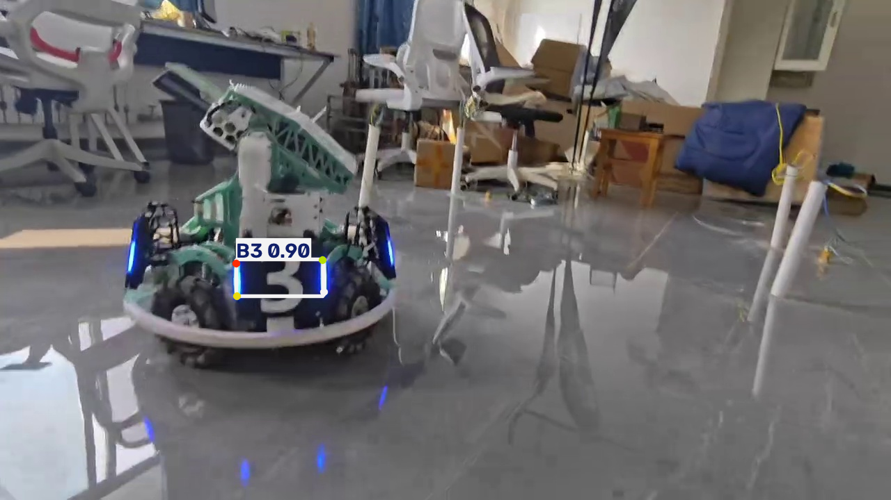
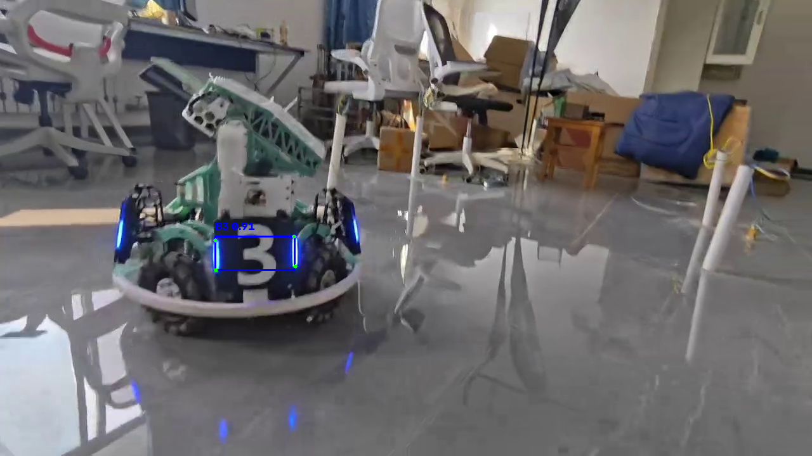

# YOLO 装甲板模型导出、推理与性能对比

RoboMaster 装甲板检测与四关键点（pose）项目。本次作业在上一份「YOLO 推理」的基础上，完成了 **PyTorch 权重导出为 ONNX**、**两种格式分别推理**，以及 **`.pt` 与 `.onnx` 的性能对比**。

## 1. 模型信息

- 模型：YOLO26n 姿态模型（`yolo26n-pose.yaml`，scale = n）
- 任务：pose（目标检测 + 关键点）
- 类别：6 类 —— `B1` `B2` `B3` `R1` `R2` `R3`
- 关键点：每个目标 4 个二维关键点（`kpt_shape = [4, 2]`）
- 权重：`best.pt`（PyTorch）→ 导出为 `best.onnx`（ONNX）

## 2. 运行环境

- 操作系统：Windows
- Python：3.12
- Ultralytics：8.4.175
- PyTorch：2.11.0+cu128
- onnxruntime-gpu：1.26.0
- OpenCV：5.0.0.93
- GPU：NVIDIA GeForce RTX 5060 Laptop GPU（CUDA）

> 本项目既可以在 GPU 上运行，也可以切换到 CPU 运行。

## 3. 项目结构

```text
yolo-armor-inference/
├── best.pt                 # PyTorch 原始权重
├── best.onnx               # 导出的 ONNX 权重
├── export.py               # 模型导出脚本
├── infer_pt.py             # .pt 推理脚本
├── infer_onnx.py           # .onnx 推理脚本
├── compare.py              # 一键对比 .pt/.onnx 并生成 comparison.md
├── make_test_image.py      # 从视频抽取干净测试帧
├── check.py                # 查看类别/模型信息
├── shape_test.py           # 查看 ONNX 输入/输出形状
├── test_model.py           # 模型检查脚本
├── comparison.md           # .pt 与 .onnx 的对比报告（可自动生成）
├── requirements.txt
├── README.md
├── .gitignore
│
├── assets/                 # 测试图片与推理结果截图
│   ├── test.jpg            # 干净测试帧（来自 video_3.mp4）
│   ├── result_pt.png       # .pt 推理结果
│   ├── result_onnx.png     # .onnx 推理结果
│   └── result_sample1/2/3.png
│
├── videos/                 # 本地视频，不纳入 Git
└── outputs/                # 推理输出，不纳入 Git
```

## 4. 安装依赖

```powershell
py -3.12 -m venv .venv
.\.venv\Scripts\Activate.ps1
python -m pip install -r requirements.txt
```

主要依赖：`ultralytics`、`onnxruntime-gpu`、`torch`、`opencv-python`、`numpy`。

## 5. 模型导出

把 `best.pt` 导出为 ONNX：

```powershell
python .\export.py
```

`export.py` 的关键设置：

```python
model.export(format="onnx", imgsz=640, opset=12, simplify=True, dynamic=False)
```

- `format="onnx"`：导出为 ONNX 格式；
- `imgsz=640`：固定输入尺寸 640×640；
- `opset=12`：使用 ONNX 算子集版本 12；
- `simplify=True`：对计算图做简化；
- `dynamic=False`：固定 batch 和尺寸（输出 shape 确定，便于后处理）。

导出后得到 `best.onnx`，可用 `shape_test.py` 查看输入/输出形状：

```powershell
python .\shape_test.py
```

输出为 `[1, 3, 640, 640]` → `[1, 18, 8400]`，其中 `18 = 4(框) + 6(类别) + 8(4个关键点×2)`。

## 6. 模型推理

两种格式使用**相同的测试图片和参数**：

```powershell
# 原始 .pt 模型（GPU）,还有要注意的这个test.jgp自己换的话再改一下
python .\infer_pt.py --source assets\test.jpg --conf 0.25 --iou 0.45 --device 0

# 导出的 .onnx 模型（自动使用 GPU）
python .\infer_onnx.py --source assets\test.jpg --conf 0.25 --iou 0.45
```

脚本会输出检测框、类别、置信度，并保存标注结果到 `outputs/`。

测试帧 `assets/test.jpg` 是从上一份作业的视频 `videos/video_3.mp4` 中抽取的干净单帧：

```powershell
python .\make_test_image.py --video videos\video_3.mp4 --out assets\test.jpg
```

## 7. 性能对比

详细对比见 [comparison.md](comparison.md)，结论如下：

也可以用 `compare.py` 一键跑两个模型并自动重新生成 `comparison.md`：

```powershell
python .\compare.py --source assets\test.jpg
```

| 对比项目 | 原始 `.pt` | 导出 `.onnx` |
|----------|-----------|-------------|
| 模型格式 | PyTorch | ONNX |
| 文件大小 | 5.62 MB | 9.72 MB |
| 纯前向耗时 | 约 24 ms | 约 8.7 ms |
| 检测目标数量 | 1 | 1 |
| 检测结果 | B3 conf=0.903 | B3 conf=0.906 |

两种格式检测效果一致（同一目标、同一位置、置信度几乎相同），ONNX 推理更快、更通用。

### 推理结果截图

原始 `.pt` 模型：



导出 `.onnx` 模型：



## 8. 遇到的问题与解决方案

### 1. ONNX 推理检测数为 0

**现象**：早期用 `assets/result_sample3.png` 测试时，ONNX 一个目标都检测不到。

**原因**：这张截图里的装甲板偏小、距离较远，letterbox 缩放后最大置信度只有约 0.076，而当时阈值设为 0.15，所以全部被过滤掉了。

**解决**：从 `video_3.mp4` 抽出一张装甲板清晰的帧（`assets/test.jpg`，置信度约 0.906），并统一阈值，问题解决。

### 2. onnxruntime GPU provider 加载失败

**现象**：`shape_test.py` 报 `cublasLt64_12.dll` 缺失，CUDA provider 创建失败。

**原因**：`onnxruntime-gpu` 的 CUDA provider 依赖 CUDA/cuDNN 运行库，但系统里没有单独安装，只有 PyTorch 自带的副本。

**解决**：在导入 onnxruntime 之前，把 `torch/lib` 目录加入 `PATH`，复用 PyTorch 自带的 CUDA/cuDNN DLL。

### 3. 无检测时的警告触发 UnicodeEncodeError

**现象**：`infer_onnx.py` 的警告信息里含 `⚠️` emoji，在 GBK 控制台下打印时报 `UnicodeEncodeError`。

**解决**：重写脚本，去掉 emoji，并统一使用纯英文日志输出，避免编码问题。

### 4. 阈值不统一导致对比不公平

**现象**：原 `.pt` 脚本默认 conf=0.25，ONNX 脚本 conf=0.15，IoU 也不同。

**解决**：两个脚本统一为 `--conf 0.25 --iou 0.45`，并使用相同输入尺寸和 GPU。

## 9. 对不同模型格式的理解与结论

- **`.pt`（PyTorch）**：训练和实验最方便，包含完整的模型结构和优化器状态，但推理时需要完整的 PyTorch 环境，单张推理的框架开销较大。
- **`.onnx`（ONNX）**：一种通用的模型交换格式，把模型"翻译"成标准计算图。ONNX Runtime 会做算子融合等图优化，因此推理更快，且不依赖 PyTorch，便于部署到不同平台。
- 导出 ONNX **不会损失检测精度**，两种格式的检测结果几乎完全一致；差异只来自浮点计算顺序的微小变化。
- 实际工程中常用流程是：用 PyTorch 训练 → 导出 ONNX → 在推理端用 ONNX Runtime（或进一步转 TensorRT/OpenVINO）部署。
