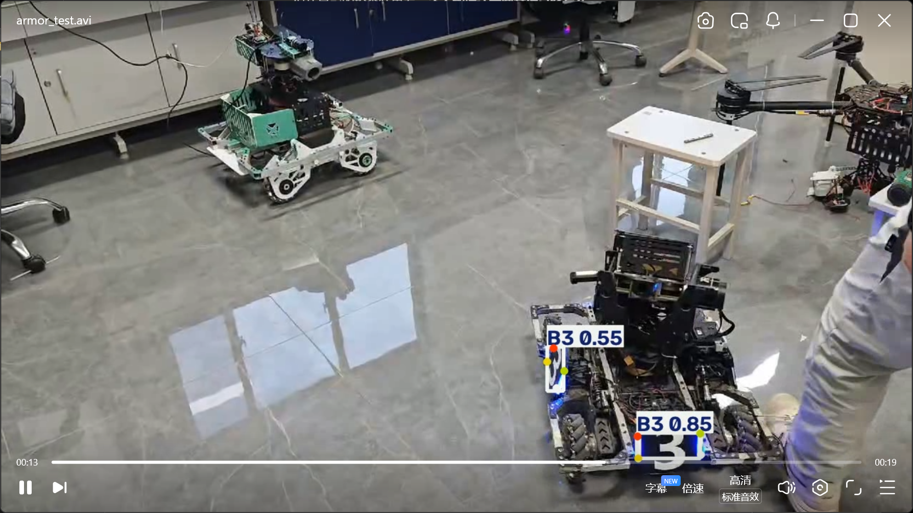

# YOLO26n Armor Plate Inference

RoboMaster armor plate detection and four-keypoint video inference project.

## 1. Project Overview

This project uses the provided YOLO26n pose model to detect six armor plate classes:

- B1
- B2
- B3
- R1
- R2
- R3

For each detected target, the model predicts a bounding box and four 2D keypoints. The inference script processes an image or video and saves an annotated result.

## 2. Environment

- Operating system: Windows
- Python: 3.12 (recommended; verify with `python --version`)
- Ultralytics: 8.4.175
- PyTorch: 2.11.0+cu128 (local environment; verify before submission)
- GPU: NVIDIA GeForce RTX 5060 Laptop GPU
- Inference device: CUDA GPU

The project can also be run on a CPU by passing `--device cpu`.

## 3. Project Structure

```text
yolo-armor-inference/
├── infer.py
├── test_model.py
├── requirements.txt
├── README.md
├── .gitignore
├── assets/
├── videos/       # Local test videos; excluded from Git
├── outputs/      # Local inference results; excluded from Git
└── best.pt       # Download separately; excluded from Git
```

## 4. Prepare the Model

Download `best.pt` from the assignment reference materials and place it in the project root:

```text
yolo-armor-inference/best.pt
```

The model weights are not included in this repository. Do not use a different model in place of the assignment-provided weights.

## 5. Install Dependencies

Create and activate a virtual environment:

```powershell
py -3.12 -m venv .venv
.\.venv\Scripts\Activate.ps1
```

Install PyTorch with a CUDA build compatible with your GPU and driver, following the official PyTorch installation instructions. Then install the project dependency:

```powershell
python -m pip install -r requirements.txt
```

Verify the environment:

```powershell
python -c "import torch; print(torch.__version__); print(torch.cuda.is_available())"
python -c "import ultralytics; print(ultralytics.__version__)"
```

## 6. Run Inference

Place your own recorded video in the `videos/` directory. Example:

```powershell
python .\infer.py --source .\videos\armor_test2.mp4
```

Specify another model or confidence threshold if needed:

```powershell
python .\infer.py --source .\videos\armor_test2.mp4 --model .\best.pt --conf 0.25 --imgsz 640
```

Run on CPU instead of GPU:

```powershell
python .\infer.py --source .\videos\armor_test2.mp4 --device cpu
```

The annotated output video is saved under:

```text
outputs/inference/
```

The output includes model-generated detections and keypoints. Check the video to confirm the bounding boxes, class labels, confidence scores, and four keypoints are visible.

## 7. Video Recording and Test Scene

- **Recording location:** D414 laboratory.
- **Recording device and orientation:** Mobile phone, landscape orientation.
- **Recording duration:**
  - `armor_test.mp4`: 20 seconds.
  - `armor_test1.mp4`: 11 seconds.
  - `armor_test2.mp4`: 20 seconds.
- **Scene description:** The videos were recorded using a mobile phone in the D414 laboratory. The camera was approximately 40–50 cm from the physical armor plate. The lighting conditions were moderate, neither particularly bright nor dark.

**Test videos:** `armor_test.mp4`, `armor_test1.mp4`, and `armor_test2.mp4`.

## 8. Test Results and Limitations

Local test of `armor_test2.mp4`:

- Frames processed: 320
- Sum of detections across frames: 36
- Model task: pose
- Keypoint shape: `[4, 2]`
- Output directory: `outputs/inference/`

The detection count is the sum across frames, not the number of unique armor plates. Some frames had zero detections. Inspect the output video and document any missed detections, false positives, incorrect classes, or inaccurate keypoints observed.

## 9. Representative Result

The following screenshot shows a representative frame from the local inference result.



## 10. Notes

- Model weights, local videos, output videos, and virtual environments are excluded from Git.
- Download the assignment-provided model and record your own test videos locally before running inference.
- The recorded test results should reflect the actual execution environment and observed model behavior.
