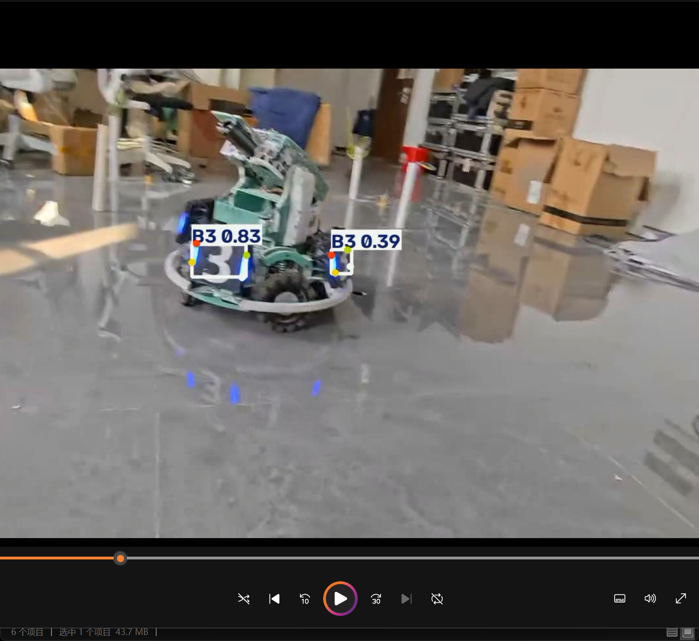
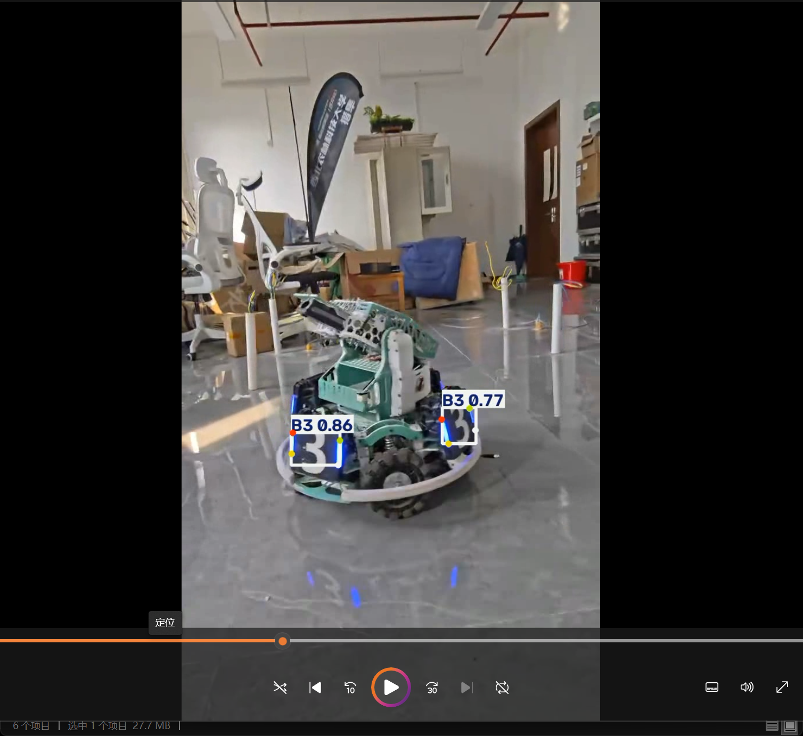
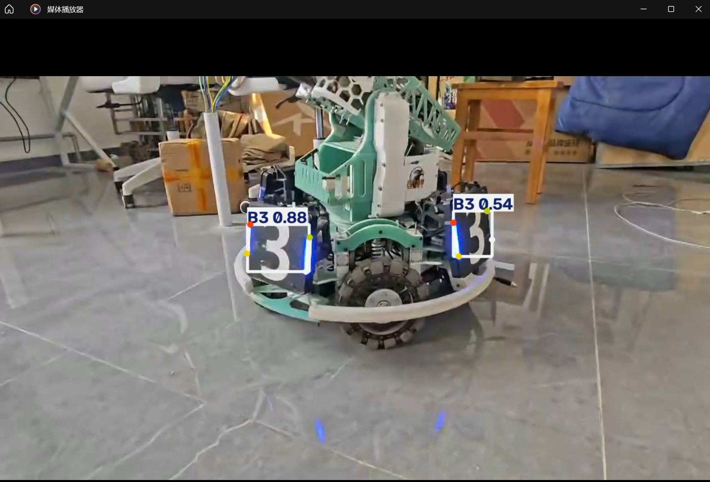

# YOLO26n 装甲板推理

RoboMaster 装甲板检测与四关键点视频推理项目。
(咕咕嘎嘎)
## 1. 项目概述

本项目使用所提供的 YOLO26n 姿态（pose）模型，检测六类装甲板：

- B1
- B2
- B3
- R1
- R2
- R3

对于每一个检测到的目标，模型会预测：

- 边界框（Bounding box）
- 类别标签
- 置信度分数
- 四个二维关键点

推理脚本可以对图片或视频进行处理，并保存标注后的推理结果。

---

## 2. 运行环境

- 操作系统：Windows
- Python：3.12
- Ultralytics：8.4.175
- PyTorch：2.11.0+cu128
- GPU：NVIDIA GeForce RTX 5060 Laptop GPU
- 推理设备：CUDA GPU

通过修改推理设备，本项目也可以在 CPU 上运行。

---

## 3. 项目结构

```text
yolo-armor-inference/
│
├── infer.py                 # YOLO26n 推理脚本
├── test_model.py            # 模型检查脚本
├── requirements.txt         # Python 依赖
├── README.md
├── .gitignore
│
├── assets/
│   ├── result_sample1.png   # video_1 推理截图
│   ├── result_sample2.png   # video_2 推理截图
│   └── result_sample3.png   # video_3 推理截图
│
├── videos/                  # 本地视频，不纳入 Git
├── outputs/                 # 推理结果，不纳入 Git
│
└── best.pt                  # 模型权重，需另行下载
```

## 4. 准备模型

下载作业提供的 YOLO26n 姿态模型：

```
best.pt
```

将模型文件放入项目根目录：

```
yolo-armor-inference/best.pt
```

由于文件体积较大，模型权重不纳入 Git 管理。

# 5. 安装依赖

### 5.1 创建虚拟环境

在项目目录中打开 PowerShell：

```powershell
py -3.12 -m venv .venv
```

激活虚拟环境：

```
.\.venv\Scripts\Activate.ps1
```

激活后，终端应显示：

```
(.venv)
```

### 5.2 安装所需依赖包

安装项目依赖：

```
python -m pip install -r requirements.txt
```

主要依赖包括：

- Python 3.12
- PyTorch
- Ultralytics
- OpenCV
- NumPy

### 5.3 验证环境

检查 PyTorch 与 CUDA：

```
python -c "import torch; print(torch.__version__); print(torch.cuda.is_available())"
```

检查 Ultralytics：

```
python -c "import ultralytics; print(ultralytics.__version__)"
```

最终环境成功支持 GPU 推理：

GPU：

```
NVIDIA GeForce RTX 5060 Laptop GPU
```

CUDA：

```
Available
```

## 6. 运行推理

### 6.1 准备输入视频

将自行录制的视频放入：

```
videos/
```

示例：

```
videos/
├── video_1.mp4
├── video_2.mp4
└── video_3.mp4
```

### 6.2 执行推理

使用默认模型运行推理：

```
python .\infer.py --source .\videos\video_1.mp4
```

对另一个视频推理的示例：

```
python .\infer.py --source .\videos\video_2.mp4
```

脚本将执行以下操作：

1. 加载 YOLO26n 姿态模型。
2. 逐帧读取输入视频。
3. 检测装甲板。
4. 预测四个关键点。
5. 绘制边界框、类别标签、置信度分数和关键点。
6. 保存标注后的视频。

### 6.3 调整参数

指定模型路径：

```
python .\infer.py --source .\videos\video_1.mp4 --model .\best.pt
```

调整置信度阈值：

```
python .\infer.py --source .\videos\video_1.mp4 --conf 0.25
```

调整图像尺寸：

```
python .\infer.py --source .\videos\video_1.mp4 --imgsz 640
```

不使用 GPU 运行：

```
python .\infer.py --source .\videos\video_1.mp4 --device cpu
```

### 6.4 输出结果

生成的推理视频保存在：

```
outputs/inference/
```

输出视频包含：

- 装甲板检测框
- 类别名称
- 置信度分数
- 四个预测关键点

示例：

```
outputs/inference/video_1.avi
outputs/inference/video_2.avi
outputs/inference/video_3.avi
```

## 7. 视频录制与测试场景

最终测试视频由本人于 D414 实验室录制。

- **录制地点：** D414 和 D402 实验室。
- **录制设备与方向：** 手机，横屏拍摄。
- **录制距离：** 距实体装甲板约 40–100 cm。
- **光照条件：** 正常室内光照，既不过亮也不过暗。
- **目标类型：** 真实的实体装甲板。

最终用于 YOLO26n 推理测试的三段自行录制视频为：

- `video_1.mp4`
- `video_2.mp4`
- `video_3.mp4`

相机从不同位置和不同视角拍摄装甲板，以验证检测模型的鲁棒性。

## 8. 测试结果与局限性

最终推理测试使用三段自行录制的视频完成。

| 视频 | 处理帧数 | 总检测数 |
|------|------|------|
| video_1.mp4 | 583 | 618 |
| video_2.mp4 | 612 | 867 |
| video_3.mp4 | 882 | 1319 |

检测数为所有已处理帧中的目标检测总数，而非唯一装甲板的数量。

模型成功生成了：

- 边界框
- 类别标签
- 置信度分数
- 四个预测的二维关键点

由于视角变化、运动模糊或图像条件的影响，部分帧仍可能存在漏检或关键点定位不准确的情况。

## 9. 典型推理结果

以下截图均提取自实际的 YOLO26n 推理结果。

### video_1.mp4 的结果




### video_2.mp4 的结果




### video_3.mp4 的结果



---

## 10. 遇到的问题与解决方案

在开发与测试过程中，遇到了以下几个问题。

### 1. Python 环境兼容性

**问题：**

项目初期，不同的 Python 版本与深度学习库版本之间产生了兼容性问题。YOLO26n 推理环境需要合适的 Python 版本以及兼容的 PyTorch 配置。

**解决方案：**

为本项目单独创建了 Python 3.12 虚拟环境：

```powershell
py -3.12 -m venv .venv
.\.venv\Scripts\Activate.ps1
```

### 2. GPU 与 CUDA 配置

**问题：**

初始环境在 GPU 加速方面存在问题。

由于 CUDA 版本与 PyTorch 安装版本不完全兼容，PyTorch 无法正确使用 NVIDIA GPU。

**解决方案：**

对 PyTorch 环境进行了调整与测试。

使用以下命令验证 GPU 是否可用：

```
python -c "import torch; print(torch.cuda.is_available())"
```

配置完成后，YOLO26n 推理成功使用 NVIDIA GeForce RTX 5060 Laptop GPU 进行 CUDA 加速。

### 3. GitHub 身份验证问题

**问题：**

在将项目仓库推送到 GitHub 时，Git 使用了另一个已缓存的 GitHub 账号，导致权限错误：

```
remote: Permission to ... denied
```

**解决方案：**

删除了存储在 Windows 凭据管理器中的错误 GitHub 凭据。

使用正确的 GitHub 账号重新完成身份验证后，项目分支成功推送至 GitHub。

### 4. 模型推理验证

**问题：**

需要检查推理结果，以确认模型是否正确生成了边界框、类别标签、置信度分数和四个预测关键点。

**解决方案：**

测试了多段自行录制的视频。通过检查生成的推理视频和截图来验证检测结果。


## 11. 说明

- YOLO26n 模型权重（`best.pt`）另行提供，由于文件体积限制未包含在本仓库中。
- 本地视频与推理输出视频均不纳入 Git 跟踪。
- README 中展示的推理结果均由本人录制的视频和实际模型运行生成。
- 本项目使用作业提供的 YOLO26n 姿态模型，未替换为其他模型。
- 仓库包含完整的推理流程，包括环境配置、推理代码、测试脚本和结果文档。
